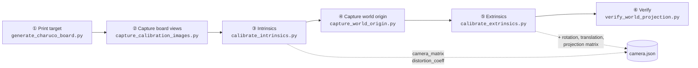
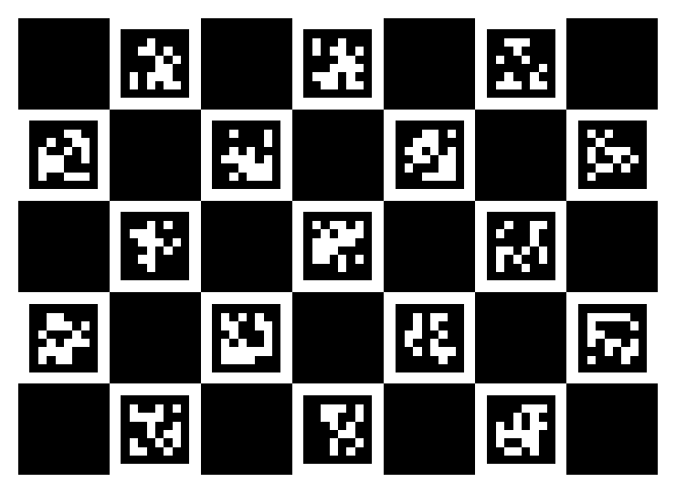
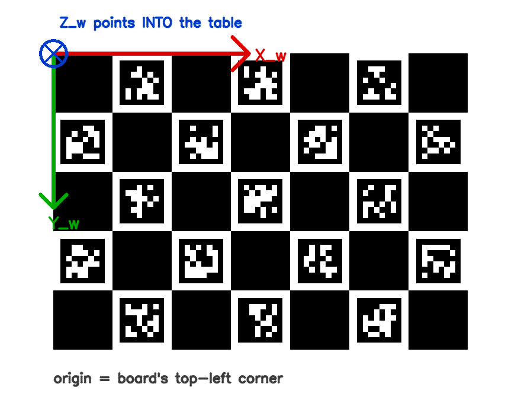

# Multi-Camera Calibration

Intrinsic and extrinsic calibration for a fixed multi-camera rig — **5 × Intel RealSense D435
and 1 × Basler ace 2 (GigE)** — using a single ChArUco target. Every camera ends up with its
own lens model **and** a pose in one shared, table-anchored world frame, so a pixel in any
camera can be turned into a 3D point on the workstation.



## Contents

- [Highlights](#highlights)
- [Repository layout](#repository-layout)
- [Setup](#setup)
- [Configuration](#configuration)
- [Calibration workflow](#calibration-workflow)
- [World coordinate frame](#world-coordinate-frame)
- [Output format](#output-format)
- [Using the results](#using-the-results)
- [Tips for a good calibration](#tips-for-a-good-calibration)
- [Docker](#docker)
- [Development and tests](#development-and-tests)

## Highlights

- **One target, one world.** All cameras observe the same ChArUco board placed at a chosen
  table corner, so their extrinsics are directly comparable without chaining camera-to-camera
  transforms.
- **Mixed hardware behind one interface.** RealSense and Basler cameras both implement the
  same small `FrameSource` interface (`src/cameras.py`); the capture scripts don't care which
  is which.
- **Offline steps need no camera SDKs.** `pyrealsense2` / `pypylon` are only imported when a
  camera is actually opened, so solving and verifying calibrations works on any machine.
- **Quality feedback at every step:** live corner-detection overlays while capturing, per-camera
  reprojection RMS after the intrinsics solve, and PnP reprojection RMS after the extrinsics solve.
- **Drop-in output schema.** `camera.json` uses the same per-camera format as the separate
  `mvs_extrinsic_calib` pipeline, so downstream code can read either.
- **Tested without hardware.** The test suite renders synthetic board photos from known poses and
  checks that the pipeline recovers them (see [Development and tests](#development-and-tests)).

## Repository layout

```
.
├── src/                          # the calibration pipeline (run these from anywhere)
│   ├── calib_config.py           #   rig + board configuration  ← edit this first
│   ├── capture_calibration_images.py   # ② interactive per-camera capture
│   ├── calibrate_intrinsics.py         # ③ lens model per camera
│   ├── capture_world_origin.py         # ④ simultaneous origin frame from all cameras
│   ├── calibrate_extrinsics.py         # ⑤ pose of each camera in the world frame
│   ├── verify_world_projection.py      # ⑥ sanity check
│   ├── cameras.py                #   RealSense / Basler behind a common FrameSource
│   ├── charuco.py                #   board construction + detection
│   ├── display.py                #   preview-window helpers
│   ├── geometry.py               #   world <-> camera transforms, pixel deprojection
│   └── json_io.py                #   camera.json read/write
├── utils/
│   ├── generate_charuco_board.py #   ① print-ready 1:1 PDF of the target
│   └── charuco_config.yaml       #     paper size, grid, dictionary
├── tests/                        # hardware-free tests (synthetic ground truth)
├── docker/                       # container with deps + camera/X11 passthrough
├── docs/                         # figures used in this README
├── requirements.txt
└── requirements-dev.txt
```

Generated data goes to `calibration_data/` in the repository root (git-ignored); set the
`CALIB_DIR` environment variable to put it elsewhere.

## Setup

**Hardware**

- 5 × Intel RealSense D435 (USB 3), 1 × Basler ace 2 (GigE, reachable on your network — you can
  confirm with Basler's pylon Viewer).
- A printed ChArUco board on a **flat, rigid** backing (foam board, aluminium composite, glass).
  See step ① below.

**Software** (Python ≥ 3.10)

```bash
python3 -m venv .venv
source .venv/bin/activate
pip install -r requirements.txt
```

> `requirements.txt` installs `opencv-contrib-python` only. Do **not** also install
> `opencv-python`: both provide `cv2` and overwrite each other, and only the contrib build has
> `cv2.aruco`.

Prefer not to install anything on the host? Use the [Docker environment](#docker).

## Configuration

Everything rig-specific is in [`src/calib_config.py`](src/calib_config.py). Edit it before you
run anything.

| Setting | Meaning |
|---|---|
| `REALSENSE_CAMERAS` | RealSense serial number → camera name. Find serials with `rs-enumerate-devices`. |
| `BASLER_CAMERAS`, `USE_BASLER` | Basler IP address (contains a `.`) or serial → camera name; switch off to calibrate RealSense only. |
| `SQUARES_X`, `SQUARES_Y` | Squares along each board axis. Must match the print. |
| `SQUARE_LENGTH_M`, `MARKER_LENGTH_M` | Physical square / marker size in metres. **Measure the print with calipers.** |
| `DICT_TYPE` | ArUco/AprilTag dictionary (default `DICT_APRILTAG_36h11`). Must match the print. |
| `MIN_CORNERS` | Minimum ChArUco corners for a frame to be accepted (default 6). |
| `MIN_FRAMES` | Fewer accepted frames than this and a camera's intrinsics are refused (default 8). |
| `RATIONAL_MODEL_MIN_FRAMES` | At or above this many frames, use the 8-coefficient rational distortion model instead of the 5-coefficient one (default 15). |
| `REALSENSE_RESOLUTION` / `_FPS` | RealSense colour stream (default 1280×720 @ 30). |
| `BASLER_RESOLUTION` | Centered ROI crop of the Basler sensor (default 4096×2160). |

Camera **names** (`camera_0`, `camera_basler`, …) become folder names and the `"camera"` field in
every output file, so choose them once and keep them stable.

## Calibration workflow

Run the steps in order. Every script can be started from any directory.

### ① Print the target

```bash
python utils/generate_charuco_board.py          # reads utils/charuco_config.yaml
```

<p align="center"></p>

Writes a 1:1-scale PDF (default: A4 landscape, 7×5 squares, 38 mm squares, 28.5 mm markers).
Print at **100 % / "Actual size"** — no "fit to page" — then **measure a square and a marker with
calipers** and put the measured values in `SQUARE_LENGTH_M` / `MARKER_LENGTH_M`. A 1 % scale error
in the print is a 1 % error in every reported distance. The script also prints the nominal values to
paste in. Use `--config` / `--output` to generate other layouts (A3, Letter, portrait, other
dictionaries).

### ② Capture calibration images

```bash
python src/capture_calibration_images.py
```

Walks through the cameras one at a time with a live corner-detection overlay (the banner turns
green once enough corners are found).

| Key | Action |
|---|---|
| `C` / `Space` | Save the current frame (only accepted if ≥ `MIN_CORNERS` corners are detected) |
| `N` | Finished with this camera → next |
| `Q` / `Esc` | Quit |

Collect **15–25 frames per camera** with the board at varied distances, tilts (up to ~45°) and
positions, including the image corners and edges. Frames go to
`calibration_data/images/<camera>/calib_NNN.png`. Re-running appends; existing frames are never overwritten.

### ③ Solve intrinsics

```bash
python src/calibrate_intrinsics.py
```

For each camera: detects the board in every saved frame, rejects weak ones, then runs
`cv2.aruco.calibrateCameraCharuco`. Prints the RMS reprojection error, focal lengths and principal
point, and writes `camera_matrix` + `distortion_coeff` to `calibration_data/images/<camera>/camera.json`.

- Fewer than `MIN_FRAMES` (8) accepted frames → the camera is skipped with an error.
- 15 or more accepted frames → rational distortion model (8 coefficients); otherwise 5.

### ④ Capture the world origin

```bash
python src/capture_world_origin.py
```

Lay the board **flat on the table with its top-left corner exactly on the point you want as the
world origin**, and make sure every camera can see it (a grid preview shows all cameras; each tile
turns green when the board is detected). Press `C` / `Space` to save one frame per camera to
`calibration_data/world_origin_raw/<camera>_origin.png`. Do not move the board or any camera between
the frames — they are taken in a single press.

### ⑤ Solve extrinsics

```bash
python src/calibrate_extrinsics.py
```

For each camera, detects the board in its origin frame and solves `solvePnP` with that camera's
intrinsics. Prints the camera's position in the world frame, its height above the table, and the PnP
reprojection RMS; then adds the pose fields to the camera's `camera.json` and writes all cameras to
`calibration_data/combined_calibration_data/camera_parameter_<timestamp>.json`.

Typical output:

```
[camera_0]
  Camera position in world (X, Y, Z) : [+0.138, +0.090, -0.653] m
  Height above tabletop (-Z)         : 0.653 m
  PnP reprojection RMS               : 0.355 px
```

### ⑥ Verify

```bash
python src/verify_world_projection.py                              # camera_0's principal point at 1 m
python src/verify_world_projection.py --camera camera_4 --pixel 640 360 --depth 0.8
```

Deprojects a pixel at a given depth into world coordinates and prints the camera position alongside
it. With the default (principal point), the world point lies exactly `--depth` metres in front of the
camera along its optical axis. For a physical check, deproject the pixel of a known mark at the depth you
measured and compare the result with a ruler on the table.

**When to re-run what.** Moved a camera → ④–⑤ (and ②–③ if its focus or lens changed). Changed focus or
lens only → ②–③, then ⑤. Moved the table origin → ④–⑤.

## World coordinate frame

<p align="center"></p>

The world frame is the ChArUco board's own frame at the moment of step ④ (OpenCV convention):

| Axis | Direction |
|---|---|
| origin | the board's top-left corner |
| **+X** | along the board's top edge, to the right |
| **+Y** | down the board's left edge |
| **+Z** | **into the table** (X × Y) |

**A camera above the table therefore has a negative Z.** Its height above the tabletop is `-Z`; that
is what the scripts print as "Height above tabletop". Units are metres.

## Output format

```
calibration_data/
├── images/<camera>/
│   ├── calib_000.png …       # step ②  raw calibration frames
│   └── camera.json           # step ③  intrinsics  →  step ⑤  + pose
├── world_origin_raw/<camera>_origin.png     # step ④
└── combined_calibration_data/
    └── camera_parameter_<timestamp>.json    # step ⑤  all cameras in one file
```

**`camera.json`** (same schema as `mvs_extrinsic_calib`):

```json
{
    "camera_matrix":     [[fx, 0, cx], [0, fy, cy], [0, 0, 1]],
    "distortion_coeff":  [k1, k2, p1, p2, k3],
    "t_param":           [[tx], [ty], [tz]],
    "r_param":           [[rx], [ry], [rz]],
    "rotation_matrix":   [[...], [...], [...]],
    "projection_matrix": [[...], [...], [...]],
    "camera":            "camera_0"
}
```

- `rotation_matrix` and `t_param` are the **world → camera** transform, `X_cam = R · X_world + t`
  (OpenCV `solvePnP` convention). `r_param` is `R` as a Rodrigues vector.
- `projection_matrix` is the 3×4 matrix `K · [R | t]`, mapping homogeneous world points to pixels
  (ignoring distortion).
- After step ③ alone, `camera.json` contains only `camera_matrix`, `distortion_coeff` and `camera`.

**Combined file:** `{"header": {...}, "cameras": [<camera.json>, ...]}`. The header records the
creation time (ISO 8601), a description of the world frame and the board geometry used.

> **Heads-up for consumers of `distortion_coeff`:** its length is **5** (plumb-bob; fewer than 15
> frames) or **8** (rational model; 15+ frames). `mvs_extrinsic_calib` always writes exactly 5, so
> code that hard-codes a 5-element vector must handle the 8-element case — or keep that camera under
> 15 frames. OpenCV's `undistortPoints` / `projectPoints` accept either length.

## Using the results

Plain NumPy, no dependency on this repo:

```python
import json
import numpy as np

cam = json.load(open("calibration_data/images/camera_0/camera.json"))
K = np.array(cam["camera_matrix"])
D = np.array(cam["distortion_coeff"])
R = np.array(cam["rotation_matrix"])
t = np.array(cam["t_param"]).reshape(3)

# world -> pixel (without distortion)
def project(X_world):
    x = K @ (R @ X_world + t)
    return x[:2] / x[2]

# pixel + depth (metres along the optical axis) -> world.  (u, v) must be undistorted.
def deproject(u, v, depth):
    X_cam = np.array([(u - K[0, 2]) * depth / K[0, 0],
                      (v - K[1, 2]) * depth / K[1, 1],
                      depth])
    return R.T @ (X_cam - t)
```

Or use the tested helpers in `src/geometry.py` (`pixel_to_world`, `camera_to_world_matrix`,
`camera_position_in_world`) and `src/json_io.py`.

## Tips for a good calibration

- **Rigid, flat board.** A bowed board is the most common cause of mediocre results.
- **Focus and exposure locked** before capturing intrinsics; don't touch the lens afterwards.
- **Diverse poses beat many poses.** Vary distance and tilt; cover the corners of the image, where
  distortion is strongest.
- **Judge the numbers.** After step ③ a reprojection RMS well under ~1 px is expected, and typically
  ≲ 0.5 px for a good capture. A higher value usually means motion blur, a warped board, or too few
  tilted views. Also check that focal lengths and principal points are plausible for the lens.
- **Sanity-check the distortion vector.** If a camera's rational-model coefficients come out very
  large, drop to the 5-coefficient model (capture fewer than 15 frames, or raise
  `RATIONAL_MODEL_MIN_FRAMES`) or add more varied views.
- **PnP RMS** in step ⑤ should be small (≈ 1 px or less). A large value means the origin frame is
  blurry, partly occluded, or the board dimensions in `calib_config.py` don't match the print.
- **Lighting:** diffuse, no glare on the board; saturated white squares hurt corner detection.

### Troubleshooting

| Symptom | Likely cause / fix |
|---|---|
| `Corners: 0` although the board is clearly visible | `DICT_TYPE`, `SQUARES_X/Y` don't match the printed board. |
| `Failed to open realsense …` | Wrong serial in `REALSENSE_CAMERAS`, USB 2 port/cable, or another process holds the camera. |
| `Failed to open basler …` | Camera not reachable on that IP (check subnet/MTU, jumbo frames), or in use by pylon Viewer. |
| Basler stream drops frames | Raise socket buffers: `sudo sysctl -w net.core.rmem_max=33554432` (done for you by `docker/run.sh`). |
| `[ERROR] … Only N valid frames` | Capture more frames; step ③ needs at least `MIN_FRAMES`. |
| Camera height prints as negative | You're reading `Z` instead of `-Z`; see [World coordinate frame](#world-coordinate-frame). |
| `Missing camera.json … Run calibrate_intrinsics.py first` | Step ⑤ needs step ③ for that camera. |

## Docker

The container bundles the Python dependencies, X11 forwarding for the preview windows, and
host-network / USB / device passthrough for the cameras.

```bash
./docker/run.sh
```

This builds the image if needed, allows the container to use your X display (revoked again on exit),
tries to raise the socket buffers for Basler streaming, and opens a shell in `/workspace/src` with the
repository bind-mounted — so `calibration_data/` appears in your checkout. Then run the steps as above
(`python capture_calibration_images.py`, …).

The container runs `privileged` with `/dev` mounted and uses the host network; that's what makes USB and GigE cameras work
without per-device configuration, but it is broad access. If a RealSense isn't detected, install its
udev rules on the host (see the
[librealsense installation guide](https://github.com/IntelRealSense/librealsense/blob/master/doc/distribution_linux.md)).

## Development and tests

```bash
pip install -r requirements-dev.txt     # or: pip install numpy opencv-contrib-python pyyaml reportlab pytest
pytest
```

No cameras required. The suite:

- renders synthetic ChArUco photos from **known camera poses** and checks that intrinsics, extrinsics
  and the pixel → world transform are recovered (including the Z-into-the-table sign convention);
- drives the interactive capture scripts with fake cameras and scripted key presses;
- checks that every module imports without `pyrealsense2` / `pypylon`, and that the board PDF is generated.

Synthetic images are noise-free pinhole renders, so they validate the **maths and plumbing**, not
real-lens accuracy — that comes from the calibration quality checks above.
